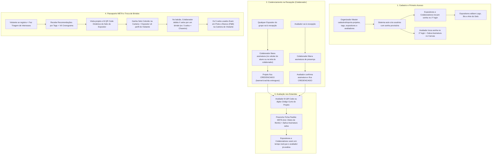

# Planejamento Funcional (MVP) — Plataforma Digital META (CEFET-MG)

> **Propósito deste documento:** Especificar exclusivamente o escopo funcional, atores, casos de uso, regras de negócio e fluxos operacionais consolidados para o MVP da **META (Mostra Específica de Trabalhos e Aplicações)** do CEFET-MG. Decisões de arquitetura, stack tecnológica e banco de dados serão tratadas em um documento técnico separado.

---

## 1. Visão Geral do Produto

A **META** é a tradicional mostra científica e tecnológica do CEFET-MG (em sua 35ª edição). Atualmente, processos críticos como credenciamento presencial, entrega de kits/banners, comprovação de presença, avaliação de estandes e o "Passaporte META" (coleta de carimbos/selos em papel para troca por brindes) dependem de controles manuais ou planilhas desconectadas.

O objetivo deste **Web App MVP (100% Responsivo — Mobile & Desktop)** é digitalizar a experiência de ponta a ponta para os **5 perfis de participantes do evento**, garantindo:
1. **Agilidade no Credenciamento** com assinatura digital no próprio dispositivo do usuário ou direto no aparelho do Colaborador.
2. **Assinatura Reutilizável para Avaliadores**, cadastrada no primeiro contato com o app para agilizar o encerramento de cada avaliação.
3. **Transparência em Tempo Real** sobre quais projetos já foram credenciados e avaliados.
4. **Passaporte META Digital** com coleta segura de selos via QR Code dinâmico e troca de brindes (marcando os selos já gastos em preto e branco na coleção).
5. **Descoberta Inteligente de Projetos** para visitantes através de triagem rápida de interesses e recomendação por tags.

---

## 2. Perfis de Usuário (Atores) e Permissões

O sistema conta com **5 perfis de acesso**:

| Perfil | Forma de Criação da Conta | Primeiro Acesso (Onboarding) | Escopo Principal de Atuação |
| :--- | :--- | :--- | :--- |
| **1. Organizador Master** | Pré-cadastrado (Seed / Admin) | Acesso direto | Acesso total. Cria/importa projetos e usuários, define avaliadores/expositores (somente ele pode alterar esses vínculos), gerencia tags, cronograma, catálogo de brindes e relatórios gerais. |
| **2. Colaborador** | Criado pelo Organizador Master (usuário + senha provisória) | **Obrigatório trocar senha** no 1º acesso | Operação do evento: realiza credenciamento de projetos e avaliadores, libera/colhe assinaturas, monitora progresso de avaliações e debita selos na troca de brindes. |
| **3. Expositor** | Criado pelo Organizador Master (manual ou auto-gerado ao cadastrar projeto) | **Obrigatório trocar senha** no 1º acesso | Qualquer expositor da equipe pode assinar o credenciamento/retirada de kit do projeto; personaliza a página pública do seu projeto (logo, bio, imagem do selo), gera QR Code dinâmico de selo para visitantes, visualiza visitantes que passaram no estande e acompanha quais avaliadores já avaliaram ou faltam avaliar. |
| **4. Avaliador** | Criado pelo Organizador Master (manual ou auto-gerado ao cadastrar projeto) | **Obrigatório trocar senha** + **Desenhar e salvar sua Assinatura Digital no Canvas** | Assina seu credenciamento na recepção, visualiza sua carteira de projetos atribuídos, escaneia o QR Code (ou digita o código numérico) do estande, preenche a ficha de avaliação padrão META e assina com 1 clique usando sua assinatura salva. |
| **5. Visitante** | **Auto-cadastro público** no App | Cria própria senha no registro + **Quiz Rápido de Triagem de Interesses** | Recebe recomendações de projetos com base na triagem, consulta cronograma e lista de estandes, escaneia QR Codes dos projetos para ganhar selos em sua Carteira Digital e troca selos por brindes. |

---

## 3. Módulos e Regras de Negócio Consolidados

### 3.1. Autenticação, Primeiro Acesso e Auto-Provisionamento
- **Login Único:** Autenticação via identificador (usuário/e-mail/matrícula) e senha.
- **Fluxo de Primeiro Acesso (Usuários Internos):**
  - Todo `Colaborador`, `Expositor` e `Avaliador` é criado pelo `Organizador Master` com credenciais provisórias e status `TROCA_SENHA_PENDENTE`.
  - No primeiro login, o usuário é obrigado a definir uma nova senha definitiva antes de acessar o sistema.
  - **Onboarding Especial do Avaliador (Cadastro de Assinatura):** Logo após trocar a senha provisória no primeiro acesso, o **Avaliador** desenha sua assinatura em um Canvas e a salva no seu perfil. Assim, quando for assinar presença no credenciamento ou finalizar avaliações nos estandes, basta clicar em **"Assinar"** (com opção de redesenhar se desejar) e a assinatura registrada é aplicada na hora.
- **Auto-Provisionamento no Cadastro de Projetos:**
  - Quando o **Organizador Master** cadastra um projeto (manualmente ou via importação de planilha do SIGAA) e informa os Expositores e Avaliadores, caso algum deles ainda não exista no banco de dados, o sistema cria automaticamente a conta daquele usuário com login e senha provisória e exibe/exporta as credenciais geradas.
- **Auto-Cadastro do Visitante + Triagem de Interesses:**
  - O visitante cria sua própria conta na tela pública de registro.
  - No primeiro acesso, responde a uma **Triagem Curta** selecionando seus temas de interesse (vinculados às tags do sistema, ex.: *Inteligência Artificial, Robótica, Machine Learning, Ecologia, Saúde, Jogos, etc.*).

---

### 3.2. Gestão de Projetos e Personalização de Estande
- **Atributos Exclusivos do Organizador Master (Imutáveis por outros perfis):**
  - Nome/Título oficial do projeto e código oficial (SIGAA).
  - **Código Numérico Curto Único e Imutável** (ex.: `4821`) e **QR Code Oficial do Projeto** (gerados automaticamente no cadastro).
  - Vínculo da equipe de **Expositores** e banca de **Avaliadores** (somente o Organizador Master pode alterar esses vínculos).
  - **Tags de Assunto:** (ex.: `Machine Learning`, `Robótica`, `IA`, `Ecologia`).
  - Localização do estande / bloco / turno de apresentação.
- **Atributos Editáveis pelos Expositores da Equipe:**
  - **Logo / Imagem de Capa** do projeto.
  - **Bio / Resumo** de apresentação do projeto para visitantes.
  - **Selo do Projeto:** Upload de uma imagem pequena/ícone que representa o carimbo daquele projeto no Passaporte Digital dos visitantes.

---

### 3.3. Credenciamento Digital (Operado pelo Colaborador)
O módulo de credenciamento controla a chegada das equipes e dos avaliadores na recepção da META:

1. **Credenciamento de Projetos (Retirada de Banner e Crachás):**
   - Qualquer integrante (`Expositor`) vinculado ao projeto pode comparecer ao balcão para credenciar a equipe e retirar o banner/crachás.
   - O **Colaborador** pesquisa pelo projeto ou pelo nome/usuário do expositor e aciona **"Liberar Assinatura de Credenciamento"**.
   - **Modo Duplo de Coleta de Assinatura:**
     - **No celular do Expositor:** Abre imediatamente a área de assinatura no app do expositor logado para ele assinar no Canvas.
     - **Direto no dispositivo do Colaborador:** Caso o expositor não esteja com o celular em mãos ou conectado, o Colaborador abre o Canvas na própria tela da recepção e o expositor assina ali mesmo.
   - Concluída a assinatura, o projeto passa para o status `CREDENCIADO` (registrando data/hora, a assinatura colhida e qual integrante da equipe retirou o material).

2. **Credenciamento de Avaliadores:**
   - O **Avaliador** chega à recepção e o **Colaborador** busca seu usuário no sistema, liberando a assinatura de credenciamento.
   - O Avaliador confirma a presença (usando sua assinatura já salva com 1 clique no seu celular ou assinando na tela do Colaborador).
   - O status do Avaliador passa para `CREDENCIADO`.
   - **Regra de Bloqueio:** Um Avaliador **só consegue avaliar projetos depois de estar `CREDENCIADO`**, e **só pode avaliar projetos que também já estejam `CREDENCIADOS`**.

---

### 3.4. Avaliação de Projetos (Padrão Oficial META)
1. **Painel do Avaliador:**
   - Lista todos os projetos que ele deve avaliar, exibindo informações básicas (Nome, Código Curto, Localização, Tags, Expositores e Status: `Pendente` ou `Avaliado`).
   - Conta com botão de **Scanner de QR Code** (e campo para digitar o **Código Numérico Curto** do projeto caso a câmera não funcione).
2. **Formulário de Avaliação Padrão META:**
   - Ao escanear o QR Code (ou digitar o código numérico) no estande do projeto, o Avaliador é direcionado para o formulário estruturado com os critérios oficiais da META:
     - **Diário de Bordo** (pontuação de 0 a 5 pontos, conforme edital da META).
     - **Relevância Científica/Tecnológica e Criatividade.**
     - **Metodologia e Profundidade do Trabalho.**
     - **Domínio do Conteúdo e Clareza na Apresentação Oral.**
     - **Organização Visual do Estande / Pôster / Protótipo.**
     - **Observações / Feedback construtivo (opcional).**
3. **Assinatura com 1 Clique no Encerramento:**
   - Ao finalizar o preenchimento das notas, o Avaliador confirma sua assinatura digital (utilizando a assinatura já cadastrada no onboarding, ou assinando na hora se preferir).
4. **Visibilidade e Sigilo das Notas:**
   - Assim que a avaliação é concluída:
     - No app dos **Expositores** do projeto: o status daquele avaliador muda imediatamente para **"Já avaliou"** (mostrando quais avaliadores estão atribuídos, quantos já avaliaram e quantos faltam, **sem revelar as notas**).
     - No painel dos **Colaboradores**: o contador de avaliações concluídas daquele projeto é atualizado em tempo real.
     - No painel do **Organizador Master**: ficam disponíveis tanto o progresso quanto as notas consolidadas e assinaturas para apuração da premiação.

---

### 3.5. Passaporte META Digital (Carteira de Selos e Troca de Brindes)
1. **Emissão Segura de Selo pelo Expositor (QR Code Dinâmico):**
   - Ao terminar de apresentar o projeto para um visitante, o **Expositor** clica em **"Gerar QR Code de Selo"**.
   - Para evitar que tirem foto do QR Code e compartilhem em grupos de mensagens, o QR Code exibido possui um **token dinâmico renovado periodicamente** (acompanhado de um código curto temporário para digitação manual caso a câmera do visitante falhe).
2. **Leitura pelo Visitante e Registro de Visita:**
   - O **Visitante** abre o scanner na sua **Carteira de Selos** e escaneia o QR Code do expositor.
   - **No app do Visitante:** Ele ganha imediatamente o selo colorido daquele projeto na sua carteira (limite de 1 selo por projeto).
   - **No app do Expositor:** O perfil do visitante passa a aparecer na lista de **"Visitantes que conheceram nosso projeto"**.
3. **Troca de Selos por Brindes (Visualização Colorido vs. Preto e Branco):**
   - A carteira do visitante exibe todos os selos que ele conquistou e a quantidade de **selos disponíveis (ativos)** para troca.
   - Quando o visitante vai até um **Colaborador** trocar selos por um brinde (ex.: *5 selos = 1 chaveiro*):
     - O Colaborador identifica o visitante (via QR Code/código da carteira ou busca por nome/e-mail) e debita a quantidade de selos correspondente ao brinde.
     - **Efeito Visual na Carteira do Visitante:** Os 5 selos debitados **não desaparecem** da coleção do visitante, mas **ficam em Preto e Branco (P&B)** com a marcação de *"Utilizado em troca de brinde"*, enquanto os selos ainda disponíveis para novas trocas permanecem **Coloridos**.

---

### 3.6. Descoberta de Projetos, Cronograma e Monitoramento
- **Recomendações por Tags (Visitante):** Na tela inicial do Visitante, uma seção **"Recomendados para Você"** cruza as respostas da triagem inicial com as tags cadastradas nos projetos pelo Organizador Master.
- **Catálogo Completo e Cronograma (Visitante):** Pesquisa livre de projetos (por nome, código ou tag) e acesso permanente ao **Cronograma Oficial do Evento**.
- **Painel de Controle Operacional (Colaborador e Organizador Master):**
  - Busca rápida de projetos mostrando: integrantes expositores, status de credenciamento do grupo, lista de avaliadores vinculados, quantos já avaliaram e quantos ainda faltam avaliar.

---

## 4. Diferenciais para Apresentação do MVP à Professora

1. **Modo Demonstração (Troca Rápida de Perfil):** Uma barra de apoio para apresentação que permite alternar instantaneamente entre os 5 perfis (`Organizador Master`, `Colaborador`, `Expositor`, `Avaliador` e `Visitante`) durante a demonstração para a professora.
2. **Importação Rápida de Planilha (SIGAA/CSV):** Permite cadastrar vários projetos de uma vez e já gerar automaticamente os usuários e senhas provisórias dos expositores e avaliadores vinculados.
3. **Folha de Estande (QR Code + Código Numérico):** Visualização pronta para impressão com o QR Code oficial e o código numérico curto imutável de cada projeto.
4. **Voto Popular (Opcional na Coleta do Selo):** Ao coletar o selo de um projeto, o visitante pode marcar o projeto como "Favorito", alimentando um ranking de Voto Popular no painel do Organizador Master.

---

## 5. Diagrama Consolidado dos Fluxos

