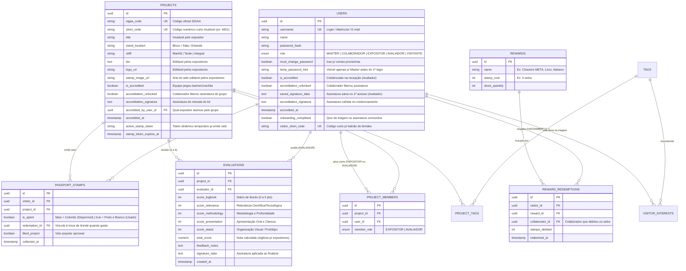

# Planejamento Técnico, Arquitetura e Regras de Engenharia — Plataforma Digital META (CEFET-MG)

> **Propósito deste documento:** Definir a stack tecnológica, arquitetura de software, modelagem de banco de dados, bibliotecas especializadas, mecanismos de segurança (QR Codes, senhas provisórias e assinaturas), sincronização em tempo real e padrões de código para a construção do MVP da **META (CEFET-MG)**.
> Este documento complementa o [PLANEJAMENTO_FUNCIONAL.md](file:///C:/Users/devpe/Desktop/Meta/PLANEJAMENTO_FUNCIONAL.md).

---

## 1. Stack Tecnológica Consolidada

A stack foi escolhida priorizando **velocidade de desenvolvimento para o MVP**, **execução impecável em celulares e desktops**, **sincronização em tempo real** durante a demonstração e **custo zero de hospedagem**:

| Camada | Tecnologia Escolhida | Justificativa para o Caso de Uso da META |
| :--- | :--- | :--- |
| **Framework Full-Stack** | **Next.js 15 (App Router) + React 19** | Unifica Frontend e Backend (Server Actions + Route Handlers) em um único repositório com deploy instantâneo na Vercel. |
| **Linguagem & Tipagem** | **TypeScript (Strict Mode)** | Garante segurança de tipos de ponta a ponta (do schema do banco no Drizzle até os formulários de avaliação e payloads de QR Code). |
| **Estilização & UI** | **Tailwind CSS + shadcn/ui + Lucide Icons** | Design System *Mobile-First* acessível, com modais/drawers responsivos perfeitos para o scanner de câmera e telas de assinatura no celular. |
| **Banco de Dados** | **PostgreSQL (via Supabase)** | Relacional robusto para controlar vínculos entre Projetos, Expositores, Avaliadores, Carteira de Selos e Transações de Brindes. |
| **ORM & Migrations** | **Drizzle ORM (`drizzle-orm` + `drizzle-kit`)** | Leve, tipagem SQL-like nativa, zero gargalo de *cold start* em ambientes serverless e excelente performance em transações. |
| **Armazenamento de Mídia** | **Supabase Storage + DataURL/SVG otimizado** | Bucket público para **Logos e Selos dos Projetos**; strings vetoriais/DataURL leves no banco para **Assinaturas Digitais**, permitindo aplicação instantânea em 1 clique. |
| **Tempo Real (Realtime)** | **Supabase Realtime (WebSockets / Broadcast & Postgres Changes)** | Atualiza instantaneamente a tela do Expositor e do Colaborador quando um projeto é credenciado, avaliado ou recebe visita. |
| **Autenticação & Sessão** | **JWT Stateless (`jose`) em Cookie `HttpOnly` + `bcryptjs`** | Controle direto e sem fricção sobre os 5 perfis (`MASTER`, `COLABORADOR`, `EXPOSITOR`, `AVALIADOR`, `VISITANTE`), flag de troca obrigatória de senha (`mustChangePassword`) e **Modo Apresentação (Quick Role Switcher)**. |
| **Formulários & Validação** | **React Hook Form + Zod** | Validação compartilhada no cliente e no servidor (Server Actions), essencial para a Ficha de Avaliação Padrão META e importação de projetos. |
| **Experiência Mobile** | **Web App Responsivo + Manifesto PWA** | Permite abrir direto pelo navegador do celular ou adicionar à tela inicial com ícone da META em tela cheia. |

---

## 2. Bibliotecas Especializadas por Funcionalidade Crítica

Para os recursos interativos que são o coração da operação da META, utilizaremos bibliotecas leves e testadas em navegadores mobile (iOS Safari e Android Chrome):

1. **Leitura de QR Code pela Câmera (`@yudiel/react-qr-scanner` ou `html5-qrcode`):**
   - Seleciona automaticamente a câmera traseira (`facingMode: "environment"`).
   - Sempre acompanhada na interface por um campo de **Digitação Manual do Código Curto** (fallback imediato caso o navegador bloqueie a câmera ou o ambiente tenha pouca luz).
2. **Geração de QR Codes (`qrcode.react`):**
   - Renderiza em SVG de alta nitidez tanto o **QR Code Fixo do Projeto** (para avaliação e folha de estande) quanto o **QR Code Dinâmico de Selo** (na tela do expositor) e o **QR Code da Carteira do Visitante** (para troca de brindes).
3. **Canvas de Assinatura Digital (`react-signature-canvas`):**
   - Suporte fluido ao toque (touchscreen no celular/tablet) e mouse (desktop).
   - Exporta traço limpo em formato compacto (`image/png` DataURL recortado ou SVG) para ser salvo no perfil do Avaliador (1º acesso) e nos termos de credenciamento/avaliação.
4. **Importação de Planilha SIGAA (`papaparse` / `xlsx`):**
   - Processa arquivos CSV/Excel para cadastro em lote de projetos, expositores e avaliadores pelo Organizador Master.

---

## 3. Arquitetura de Pastas do Projeto (Feature-Based / Modular)

Organizaremos o código por **domínio de negócio** dentro de `src/`, evitando espalhar regras em pastas genéricas gigantes:

```text
src/
├── app/                          # Rotas do Next.js (App Router)
│   ├── (public)/                 # Login, Auto-cadastro de Visitante, Cronograma Público
│   ├── (onboarding)/             # Troca obrigatória de senha, Cadastro de Assinatura (Avaliador), Quiz de Triagem (Visitante)
│   ├── (dashboard)/              # Área logada adaptativa por perfil
│   │   ├── master/               # Gestão de projetos, usuários, brindes, importação SIGAA e apuração
│   │   ├── colaborador/          # Credenciamento (Projetos/Avaliadores), Radar de Avaliações, Débito de Selos
│   │   ├── expositor/            # Meu Projeto (Logo, Bio, Selo), Emissor de QR Code de Selo, Status de Avaliadores e Visitantes
│   │   ├── avaliador/            # Meus Projetos a Avaliar, Scanner de Avaliação, Ficha Padrão META
│   │   └── visitante/            # Recomendados, Explorar Projetos, Carteira de Selos (Colorido vs P&B), QR Code de Troca
│   └── api/                      # Endpoints auxiliares (seed, exportação, healthcheck)
├── db/                           # Configuração do Drizzle ORM
│   ├── schema.ts                 # Definição de todas as tabelas e relações do PostgreSQL
│   ├── index.ts                  # Cliente de conexão (Supabase Pooler)
│   └── seed.ts                   # População inicial com dados realistas da 35ª META para demonstração
├── features/                     # Módulos de negócio isolados (Actions, Componentes, Schemas Zod)
│   ├── auth/                     # Login, JWT, troca de senha, Demo Profile Switcher
│   ├── projects/                 # CRUD de projetos, tags, código curto, folha de estande
│   ├── accreditation/            # Credenciamento de equipes e avaliadores + Modo Duplo de Assinatura
│   ├── evaluation/               # Ficha Padrão META, validação de QR Code e assinatura com 1 clique
│   ├── passport/                 # Emissão de QR Code dinâmico, coleta de selos, débito de brindes (P&B)
│   └── recommendations/          # Quiz de triagem do visitante e motor de recomendação por tags
├── components/
│   ├── ui/                       # Componentes base do shadcn/ui (Button, Dialog, Sheet, Badge, etc.)
│   └── shared/                   # Scanner QR com fallback de código, Canvas de Assinatura, Header Responsivo
└── lib/                          # Utilitários (Supabase client, Realtime hooks, gerador de tokens TOTP/códigos curtos)
```

---

## 4. Modelagem do Banco de Dados (Schema Relacional no Drizzle)

O modelo de dados foi desenhado para suportar todas as regras do [PLANEJAMENTO_FUNCIONAL.md](file:///C:/Users/devpe/Desktop/Meta/PLANEJAMENTO_FUNCIONAL.md) sem redundâncias:



> [!IMPORTANT]
> **Garantia de Unicidade no Banco (Constraints):**
> - `UNIQUE(project_id, evaluator_id)` na tabela `EVALUATIONS`: garante que um avaliador nunca avalie o mesmo projeto duas vezes.
> - `UNIQUE(visitor_id, project_id)` na tabela `PASSPORT_STAMPS`: garante que um visitante só ganhe **1 selo por projeto visitado**.

---

## 5. Desenho Técnico dos Mecanismos Especiais

### 5.1. Como funciona o Status Colorido vs. Preto e Branco (P&B) nos Selos
- Cada selo conquistado pelo visitante cria um registro na tabela `PASSPORT_STAMPS` com `is_spent = false`.
- O **Saldo Disponível** do visitante é simplesmente a contagem de registros dele onde `is_spent = false`.
- Quando o **Colaborador** debita `N` selos (ex.: `5 selos` para um Chaveiro):
  - O sistema executa uma transação atômica (`db.transaction`) que seleciona os **5 selos mais antigos disponíveis** (`is_spent = false` ordenados por `collected_at ASC`) daquele visitante e os atualiza para `is_spent = true`, vinculando-os ao `redemption_id`.
  - Na interface da Carteira do Visitante:
    - Selos com `is_spent === false` são renderizados em **cores vibrantes** com selo de *"Disponível para troca"*.
    - Selos com `is_spent === true` recebem a classe Tailwind `grayscale opacity-60 contrast-125` (**Preto e Branco**) com um carimbo visual *"Usado em brinde"*.

### 5.2. Como funciona o QR Code Dinâmico de Selo (Anti-Foto no WhatsApp)
- Quando o **Expositor** abre a tela *"Emitir Selo para Visitante"*, o app gera (via Server Action ou cálculo determinístico HMAC com janela de 60 segundos) um **Código de Selo Temporário de 6 dígitos** (ex.: `S-849201`) válido por 60 segundos.
- O QR Code exibido na tela codifica `{ type: "META_STAMP", projectId, token: "849201" }` e mostra uma barra regressiva de renovação.
- Se a câmera do visitante não ler, o visitante pode simplesmente digitar os 6 dígitos (`849201`) que estão aparecendo na tela do expositor naquele momento.

### 5.3. Como funciona o Credenciamento e Assinatura em Tempo Real
1. O **Colaborador** clica em *"Liberar Assinatura"* para um Projeto ou Avaliador -> atualiza `accreditation_unlocked = true` no banco e dispara um evento no canal **Supabase Realtime**.
2. **Opção A (No celular do Expositor/Avaliador):** O cliente WebSocket detecta `accreditation_unlocked = true` instantaneamente e abre o modal de assinatura na tela do usuário.
3. **Opção B (Na tela do Colaborador):** O Colaborador clica em *"Coletar assinatura neste aparelho"*, abre o Canvas imediatamente na própria tela, o participante assina (ou o Avaliador usa a assinatura salva) e o status muda para `is_accredited = true`.

### 5.4. Barra Flutuante "Modo Apresentação para Professora" (Demo Switcher)
- Para que a sua demonstração para a professora seja fluida e sem perda de tempo digitando senhas toda hora:
  - Incluiremos um componente discreto e recolhível no canto da tela (`DemoRoleSwitcher`) habilitado em ambiente de demonstração.
  - Com **1 clique**, você poderá alternar ao vivo entre contas pré-configuradas de **Organizador Master**, **Colaborador (Recepção/Brindes)**, **Expositor (Projeto de Robótica/IA)**, **Avaliador (Banca)** e **Visitante (Passaporte)**, mostrando toda a jornada acontecendo em tempo real.

---

## 6. Regras de Programação e Padrões de Qualidade

1. **Responsividade Obrigatória (Mobile-First):**
   - Todas as telas devem ser projetadas primeiro para viewports mobile (`360px–430px`) com navegação inferior (*Bottom Navigation Bar*) no celular e barra lateral (*Sidebar*) em telas desktop (`md:` e `lg:`).
   - Botões de ação de campo (Escanear QR Code, Emitir Selo, Liberar Assinatura, Assinar) devem ter altura mínima de `48px` para fácil toque com uma mão em pé nos corredores da META.
2. **Segurança e Autorização no Servidor (RBAC):**
   - Nunca confiar apenas no ocultamento de botões no frontend. Toda *Server Action* deve verificar o papel (`role`) do usuário logado antes de executar alterações no banco:
     - Alterar título, código, tags, expositores ou avaliadores de um projeto -> exige `role === "MASTER"`.
     - Liberar credenciamento ou debitar selos -> exige `role === "COLABORADOR"` ou `"MASTER"`.
     - Enviar avaliação -> exige `role === "AVALIADOR"`, `user.is_accredited === true`, `project.is_accredited === true` e vínculo ativo em `PROJECT_MEMBERS`.
     - Sigilo de notas -> queries que retornam dados para `EXPOSITOR` ou `VISITANTE` **jamais** selecionam as colunas `score_*`, `total_score` ou `feedback_notes` da tabela `EVALUATIONS`.
3. **Resiliência e Feedback Visual Imediato:**
   - Todo envio de formulário ou leitura de QR Code deve apresentar estado de carregamento (`loading spinner` / botão desabilitado para evitar duplo clique) e notificações visuais claras (`Toast` via `sonner`) de sucesso ou erro explicativo em Português (`pt-BR`).
4. **Seed Rico da 35ª META Pronto para Demonstração:**
   - O projeto contará com um script `npm run db:seed` que popula automaticamente projetos reais/inspirados na META do CEFET-MG (com tags de *Machine Learning, Robótica, IA, Ecologia, Saúde, Automação*), avaliadores atribuídos, cronograma do evento, catálogo de brindes (Chaveiro, Livro, Botton, Caneca) e visitantes de teste.
