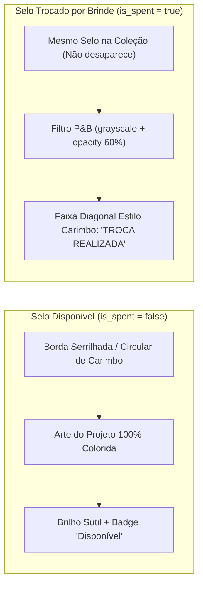

# Planejamento Visual, Design System e Regras de UI/UX — Plataforma Digital META (CEFET-MG)

> **Propósito deste documento:** Especificar a identidade visual, paleta de cores (Light & Dark Mode), tipografia, anatomia de componentes, padrões de interação mobile-first e regras de experiência do usuário (UX) para o MVP da **35ª META (Mostra Específica de Trabalhos e Aplicações)** do CEFET-MG.
> Este documento complementa o [PLANEJAMENTO_FUNCIONAL.md](file:///C:/Users/user/Desktop/meta-cefet/PLANEJAMENTO_FUNCIONAL.md) e o [PLANEJAMENTO_TECNICO.md](file:///C:/Users/user/Desktop/meta-cefet/PLANEJAMENTO_TECNICO.md).

---

## 1. Direção de Arte e Referências Visuais

A identidade visual do Web App nasce do equilíbrio entre a **identidade gráfica oficial da 35ª META** (uma fita tridimensional dobrada em polígonos com textura de pontos *halftone* que percorre o espectro do Azul Marinho ao Amarelo) e um **Design System Minimalista Corporativo Limpo** (inspirado em referências como *shadcn/ui*, *Linear* e *Vercel*).

### 1.1. Princípios Visuais Consolidados
1. **Minimalismo Corporativo Limpo no Layout Base:**
   - O corpo da aplicação utiliza superfícies limpas em escala **Slate / Navy Escuro** (substituindo completamente o marrom da tipografia original do cartaz por tons de azul-ardósia profundos e elegantes, em sintonia com o CEFET-MG e com a ponta esquerda da fita da logo).
   - A explosão de cores da fita da 35ª META não polui o fundo das telas: ela é reservada estrategicamente para o **cabeçalho institucional**, **ações primárias**, **identificação instantânea dos 5 perfis de acesso**, **tags de áreas do conhecimento** e o **Passaporte META Digital**.
2. **Suporte Completo a Light Mode (Padrão) e Dark Mode:**
   - **Light Mode (Padrão Operacional):** Projetado para alta legibilidade sob a iluminação forte dos pátios, corredores e auditórios do CEFET-MG durante o dia.
   - **Dark Mode (Nativo):** Construído sobre tons *Deep Slate/Navy* (`#090D16` / `#0F172A`), onde os acentos vibrantes da fita da META (Azul Royal, Magenta, Laranja) ganham destaque tecnológico sofisticado.
3. **Contraste de Linguagem no Passaporte META:**
   - Enquanto os painéis administrativos e operacionais seguem o rigor minimalista corporativo, a **Carteira de Selos (Passaporte META)** traz uma experiência **lúdica e tátil de passaporte físico**, com selos de borda serrilhada/carimbo, animação de "carimbada" ao coletar e conversão visual imediata para **Preto e Branco (P&B)** com faixa *"TROCA REALIZADA"* quando gastos em brindes.

---

## 2. Paleta de Cores Oficial (Tokens Semânticos & Temas)

### 2.1. Cores Extraídas da Fita da 35ª META (Brand Spectrum)
Extraídas diretamente dos segmentos geométricos da logo oficial da 35ª META:

| Nome do Token | Hexadecimal | Papel no Design System |
| :--- | :--- | :--- |
| `meta-navy` | `#1E3A8A` | Ponta inicial da fita; cor de identidade do perfil **Avaliador** e acento institucional CEFET-MG. |
| `meta-blue` | `#1565C0` | **Cor Primária Global (Primary)** de botões e links; cor de identidade do perfil **Expositor**. |
| `meta-plum` | `#6A1B4D` | Centro esquerdo da fita (Vinho/Roxo); cor de identidade do perfil **Organizador Master**. |
| `meta-magenta` | `#D81B60` | **Cor Secundária/Destaque (Accent)** para engajamento; cor de identidade do perfil **Visitante** e Passaporte. |
| `meta-orange` | `#F57C00` | Dobra direita da fita; cor de identidade do perfil **Colaborador** (Recepção/Operação) e alertas. |
| `meta-yellow` | `#FBC02D` | Ponta final da fita; usada em destaques de gamificação, selos especiais, favoritos e estrelas. |

> **Gradiente Oficial 35ª META (`bg-meta-gradient`):**
> `linear-gradient(90deg, #1E3A8A 0%, #1565C0 22%, #6A1B4D 48%, #D81B60 70%, #F57C00 88%, #FBC02D 100%)`
> *Regra de uso:* Aplicado apenas em detalhes finos (ex.: barra superior de `3px` no topo do cabeçalho, borda da pílula do *Demo Switcher* e cabeçalho do Passaporte Digital).

---

### 2.2. Escala de Neutros (Slate / Navy — Sem Texto Marrom)

> [!IMPORTANT]
> **Regra Estrita de Cores de Texto:** O marrom escuro presente na fonte do cartaz original **não deve ser utilizado** em textos, bordas ou fundos da interface. Toda a tipografia e estrutura neutra utiliza a família **Slate (Azul-Ardósia)**.

| Token Semântico | Light Mode (Padrão) | Dark Mode | Aplicação |
| :--- | :--- | :--- | :--- |
| `--background` | `#F8FAFC` *(Slate 50)* | `#090D16` *(Deep Navy)* | Fundo geral da página |
| `--surface` / `--card` | `#FFFFFF` *(Branco Puro)* | `#0F172A` *(Slate 900)* | Cards, painéis, tabelas e modais |
| `--surface-elevated` | `#F1F5F9` *(Slate 100)* | `#1E293B` *(Slate 800)* | Inputs, hover de linhas, pílulas inativas |
| `--foreground` (Texto Principal) | `#0F172A` *(Slate 900)* | `#F8FAFC` *(Slate 50)* | Títulos, nomes de projetos, textos principais |
| `--muted-foreground` (Texto Secundário) | `#475569` *(Slate 600)* | `#94A3B8` *(Slate 400)* | Subtítulos, descrições, legendas e metadados |
| `--border` | `#E2E8F0` *(Slate 200)* | `#1E293B` *(Slate 800)* | Divisórias, bordas de cards (`1px solid`) e inputs |
| `--primary` | `#1565C0` *(Meta Blue)* | `#3B82F6` *(Blue 500)* | Botões de ação principal, estados ativos |
| `--accent` | `#D81B60` *(Meta Magenta)* | `#EC4899` *(Pink 500)* | Destaques do Passaporte, CTAs de Visitante |

---

### 2.3. Cores Semânticas de Identidade por Perfil (Role Theming)

Para que o usuário (e a banca durante a apresentação com o *Demo Role Switcher*) identifique em **menos de 1 segundo** qual dos 5 perfis está ativo na tela, o cabeçalho e o badge de perfil assumem a cor correspondente da fita da META:

| Perfil (`Role`) | Cor Principal | Hex (Light / Dark Badge) | Ícone Lucide Padrão | Contexto Visual |
| :--- | :--- | :--- | :--- | :--- |
| **1. Organizador Master** | **Vinho / Roxo META** | `#6A1B4D` / `#A855F7` | `ShieldCheck` | Autoridade, governança global e apuração de notas. |
| **2. Colaborador** | **Laranja META** | `#F57C00` / `#FB923C` | `ScanLine` / `BadgeCheck` | Operação de campo ágil (credenciamento e balcão de brindes). |
| **3. Expositor** | **Azul Royal META** | `#1565C0` / `#60A5FA` | `Presentation` | Ciência, tecnologia, estande do projeto e emissão de selo. |
| **4. Avaliador** | **Azul Marinho / Indigo** | `#1E3A8A` / `#818CF8` | `ClipboardCheck` | Rigor acadêmico, avaliação oficial e assinatura digital. |
| **5. Visitante** | **Magenta META** | `#D81B60` / `#F472B6` | `Stamp` / `Compass` | Descoberta de projetos, entusiasmo e coleção de selos. |

---

### 2.4. Cores de Status Operacional
- **Credenciado / Avaliado / Selo Ativo (Sucesso):** Emerald (`#10B981` texto/ícone, fundo `#ECFDF5` no Light e `#064E3B/40` no Dark).
- **Aguardando / Pendente (Atenção):** Amber (`#F59E0B` texto/ícone, fundo `#FFFBEB` no Light e `#78350F/40` no Dark).
- **Bloqueado / Não Credenciado / Erro (Perigo):** Rose (`#E11D48` texto/ícone, fundo `#FFF1F2` no Light e `#881337/40` no Dark).
- **Selo Gasto em Brinde (Inativo / P&B):** Slate Neutro (`#64748B`, filtro `grayscale(100%) opacity-60 contrast-125`).

---

## 3. Tipografia e Hierarquia Escalar

A combinação tipográfica homenageia o aspecto geométrico/tecnológico de `"35ª META"` nos títulos sem abrir mão da legibilidade corporativa limpa em tabelas e formulários:

1. **Fonte de Títulos e Cabeçalhos (`--font-display`):** **`Space Grotesk`** (ou **`Outfit`** via `next/font/google`)
   - *Características:* Traços geométricos e angulares modernos que dialogam com os polígonos da logo da 35ª META.
   - *Uso:* Nome do evento, títulos de páginas (`h1`, `h2`), títulos de projetos nos cards, contadores de selos e placares de avaliação.
   - *Pesos:* `600 (SemiBold)` e `700 (Bold)`, `tracking-tight` (`-0.02em`).
2. **Fonte de Corpo e Interface (`--font-sans`):** **`Inter`** (ou **`Plus Jakarta Sans`**)
   - *Características:* Neutro corporativo limpo, altíssima legibilidade em telas pequenas de celular.
   - *Uso:* Labels de formulários, critérios da ficha de avaliação, descrições (bio) dos projetos, tabelas e botões.
   - *Pesos:* `400 (Regular)`, `500 (Medium)` e `600 (SemiBold)`.
3. **Fonte Monoespaçada (`--font-mono`):** **`JetBrains Mono`**
   - *Uso obrigatório em:*
     - **Código Numérico Curto do Projeto** (ex.: `#4821`).
     - **Token Dinâmico Temporário de Selo** (ex.: `849 201`).
     - **Código Oficial SIGAA** e **Código Curto da Carteira do Visitante**.

---

## 4. Anatomia dos Componentes e Regras de UI

### 4.1. Geometria, Bordas e Sombras (Estilo Minimalista `shadcn/ui`)
- **Raio de Borda (`Border Radius`):**
  - Cards e painéis principais: `rounded-xl` (`12px`).
  - Botões, inputs e selects: `rounded-lg` (`8px`).
  - Badges de status, tags de assuntos e pílulas de nota: `rounded-full` (`9999px`).
- **Bordas e Elevação:**
  - Cards usam borda sutil de `1px solid var(--border)` com sombra suave `shadow-sm` no Light Mode e brilho de borda sutil (`border-slate-800`) no Dark Mode.
  - Nenhum card deve usar bordas grossas marrons ou sombras pesadas; a limpeza visual é prioridade.

---

### 4.2. Passaporte META Digital (Design Lúdico de Passaporte Físico)
A Carteira de Selos do Visitante é o componente de maior apelo visual do aplicativo:



1. **Cabeçalho do Passaporte:**
   - Simula a capa/topo de um passaporte oficial da **35ª META — CEFET-MG**, exibindo o nome do visitante, seu QR Code/Código de Troca rápida e dois contadores destacados:
     - **Saldo Disponível para Brindes** (em destaque colorido Magenta/Amarelo).
     - **Total de Projetos Visitados** (histórico completo da coleção).
2. **Design do Selo (Stamp Card):**
   - Formato de selo postal ou carimbo circular/octogonal com borda tracejada/serrilhada (`border-dashed` ou máscara SVG de selo).
   - **Animação de Coleta ("Carimbada"):** Quando o visitante escaneia o QR Code dinâmico do expositor, o novo selo entra na tela com uma animação de escala (`scale(1.8) -> scale(1.0)` com leve rotação de `-4deg` e feedback vibratório `navigator.vibrate(100)` no celular), simulando um carimbo batendo no papel.
3. **Regra Visual Colorido vs. Preto e Branco (P&B):**
   - **Disponível (`is_spent = false`):** Arte do selo em cores vivas, borda acesa na cor da categoria do projeto e indicador ativo.
   - **Utilizado (`is_spent = true`):** O selo **permanece visível na grade** para orgulho do visitante, porém renderizado com `grayscale contrast-125 opacity-60` e sobreposto por um carimbo diagonal estilizado **`"USADO EM BRINDE"`** (com a data/hora ou nome do brinde resgatado no tooltip).

---

### 4.3. Ficha de Avaliação Padrão META (Botoeiras Rápidas *One-Handed*)
Como os avaliadores preenchem a ficha em pé nos corredores da mostra:
- **Proibido o uso de sliders de arrastar ou selects ocultos para notas.**
- **Botoeiras de Toque Rápido (Segmented Pill Buttons):**
  - Para cada critério oficial da META (ex.: *Diário de Bordo [0 a 5]*, *Relevância Científica*, *Metodologia*, *Apresentação Oral*, *Estande/Protótipo*), exibir uma linha de botões grandes (`min-h-[48px]`) lado a lado com os valores numéricos.
  - Ao tocar na nota, a pílula preenche imediatamente com o Azul META (`#1565C0`), exibindo feedback claro.
- **Barra Fixa de Nota Parcial + Assinatura em 1 Clique:**
  - No rodapé do formulário, o avaliador vê a soma automática da nota (sigilosa para terceiros) e o botão primário **"Aplicar Minha Assinatura Salva e Concluir"** (mostrando a miniatura da assinatura que ele cadastrou no onboarding, com link secundário *"Redesenhar assinatura"* caso deseje).

---

### 4.4. Canvas de Assinatura Digital (Regra do "Papel Real")
- **Regra Invariável de Contraste (Light & Dark Mode):**
  - Mesmo quando o aplicativo estiver em **Dark Mode**, a caixa do Canvas de assinatura (`react-signature-canvas`) **deve sempre ter fundo claro `#F8FAFC` (Papel) com linha guia pontilhada em `#CBD5E1` e traço da caneta em `#0F172A` (Azul Marinho quase preto)**.
  - **Motivo:** Garante que a imagem salva (SVG/PNG DataURL) tenha fidelidade documental e possa ser exibida tanto em telas claras quanto em relatórios de credenciamento e atas de avaliação impressas para a coordenação da META sem ficar invisível (branco no branco).

---

### 4.5. Scanner de QR Code e Assinatura em *Bottom Sheets* (Gavetas Deslizantes)
- Em dispositivos móveis, acionar **"Escanear QR Code"**, **"Gerar QR Code Dinâmico de Selo"** ou **"Assinar Credenciamento"** nunca tira o usuário do contexto da página atual:
  - Abre um **Bottom Sheet (`Sheet` / `Drawer` deslizando de baixo para cima)** ocupando ~85% da altura da tela.
  - No Desktop, o mesmo componente renderiza automaticamente como um **Modal Central (`Dialog`)**.
- **Alternância Instantânea Câmera / Código Manual:**
  - Todo Drawer de Scanner possui no topo um *Tabs Switcher* de 2 opções: **`[ 📷 Ler QR Code ]`** e **`[ 🔢 Digitar Código ]`**.
  - Se a câmera demorar ou falhar, com 1 toque o Avaliador ou Visitante digita os 4 ou 6 dígitos numéricos grandes em fonte monoespaçada.

---

### 4.6. Pílula Flutuante "Modo Apresentação" (`DemoRoleSwitcher`)
Para brilhar na apresentação para a professora:
- **Posição:** Canto inferior direito (`fixed bottom-20 right-4 md:bottom-6 md:right-6 z-50`), acima da barra de navegação mobile.
- **Visual Recolhido:** Uma pílula compacta com borda animada no gradiente da 35ª META (`bg-slate-900 text-white shadow-xl`), mostrando o ícone e o perfil atual: `🎭 Demo: Avaliador ▾`.
- **Visual Expandido (Popover/Sheet):** Lista os **5 perfis da plataforma** com suas respectivas cores da fita META (Master Vinho, Colaborador Laranja, Expositor Azul, Avaliador Navy, Visitante Magenta). Ao clicar em qualquer um, troca a sessão instantaneamente e atualiza a tela ao vivo.

---

## 5. Layout Responsivo e Navegação por Dispositivo

```text
+-------------------------------------------------------------------+
| BARRA DE TOPO GRADIENTE 35ª META (3px: Navy->Blue->Magenta->Yel)  |
+-------------------------------------------------------------------+
| [Logo 35ª META]   [Badge Perfil Colorido]      [☀️/🌙] [Perfil/Sair]|
+-------------------------------------------------------------------+
|                     |                                             |
|  SIDEBAR (Desktop)  |   ÁREA DE CONTEÚDO PRINCIPAL (Container)    |
|  - Início / Painel  |   - Cards limpos em Slate/White             |
|  - Ação Principal   |   - Filtros horizontais em pílulas          |
|  - Projetos / Lista |   - Grid responsivo (1 col mobile,          |
|  - Cronograma       |     2 cols tablet, 3 cols desktop)          |
|                     |                                             |
+---------------------+---------------------------------------------+
|        [🎭 Pílula Flutuante Modo Demo (Canto Inferior Direito)]   |
+-------------------------------------------------------------------+
| [🏠 Início]   [🔍 Projetos]   [📷 ESCANEAR]   [🎫 Carteira/Status] | <-- BOTTOM NAV (Apenas Mobile)
+-------------------------------------------------------------------+
```

1. **Mobile (`< 768px`):**
   - **Header Compacto Fixo:** Logo da 35ª META à esquerda, Badge colorido do perfil ativo ao centro/direita e botão de alternância Light/Dark Mode.
   - **Bottom Navigation Bar Fixa (`h-16`):** 4 atalhos principais adaptados ao perfil logado, com o botão central de ação de campo (ex.: *Escanear QR Code* para Avaliador/Visitante ou *Emitir Selo* para Expositor) levemente destacado.
2. **Desktop (`>= 768px`):**
   - **Sidebar Lateral Esquerda (`w-64`):** Navegação completa, resumo do status de credenciamento do usuário logado e atalhos rápidos.
   - **Tabelas e Grades Amplas:** Visão lado a lado para o **Organizador Master** e **Colaborador** gerenciarem credenciamento, radar de avaliações e débito de brindes com agilidade.

---

## 6. Checklist de Regras de Ouro de UI/UX (Do's & Don'ts)

- ✅ **DO:** Usar sempre a família **Slate (`#0F172A`, `#475569`)** para textos no Light Mode e **`#F8FAFC` / `#94A3B8`** no Dark Mode.
- ❌ **DON'T:** Nunca usar marrom em textos corridos, títulos de tabelas ou bordas de componentes.
- ✅ **DO:** Garantir área mínima de toque de **`48px x 48px`** em todos os botões usados em pé nos corredores (Scanner, Notas da Avaliação, Liberar Assinatura, Emitir Selo).
- ❌ **DON'T:** Nunca deixar o usuário sem alternativa ao QR Code — todo QR Code gerado na tela deve exibir seu **Código Numérico em `JetBrains Mono` grande** logo abaixo, e todo leitor deve permitir digitação manual.
- ✅ **DO:** Manter os selos já trocados por brindes na carteira do visitante, aplicando **Preto e Branco (`grayscale`) + carimbo diagonal `"TROCA REALIZADA"`**.
- ✅ **DO:** Manter o Canvas de assinatura sempre com fundo claro (`#F8FAFC`) e tinta escura (`#0F172A`), independentemente do tema Light ou Dark ativo.
